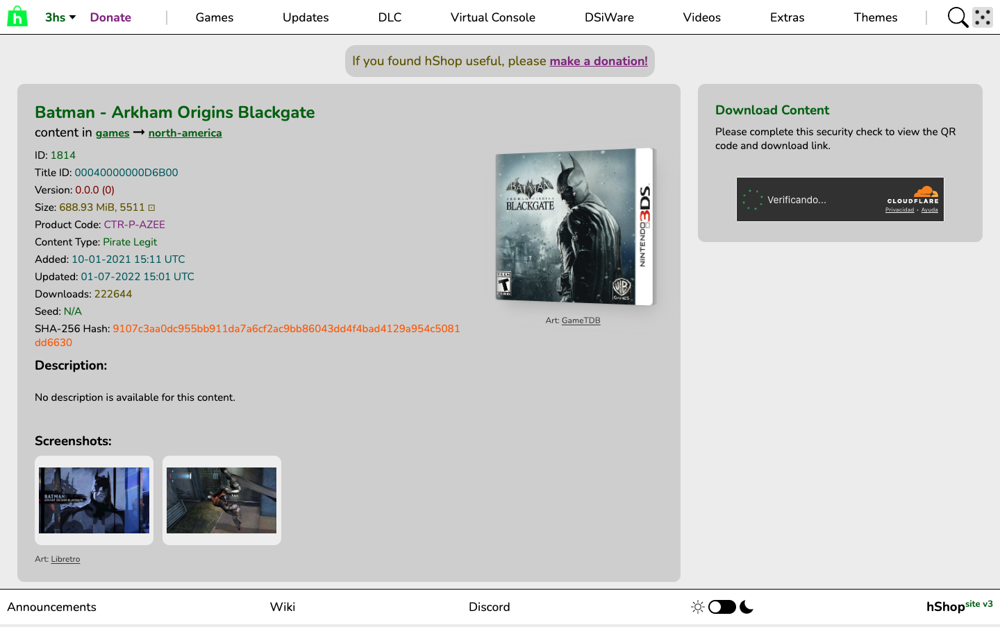
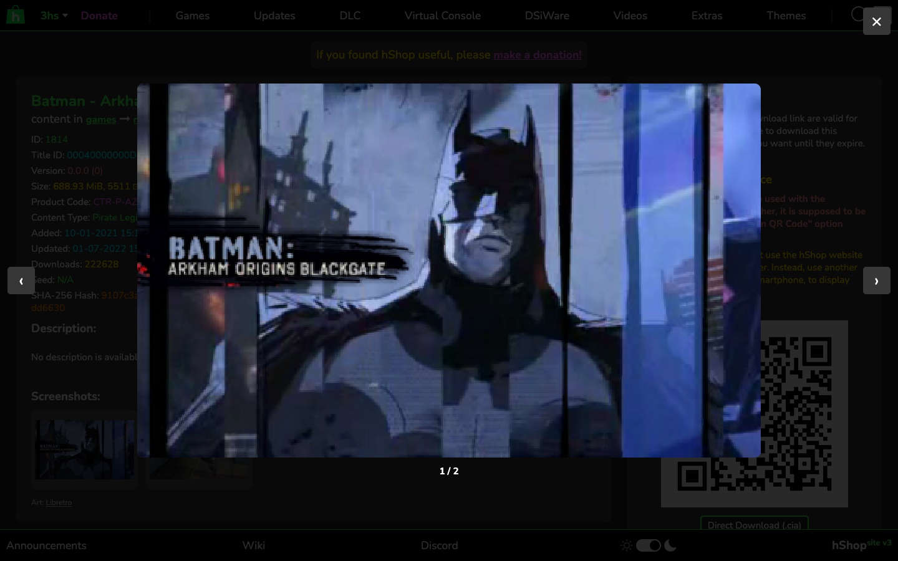
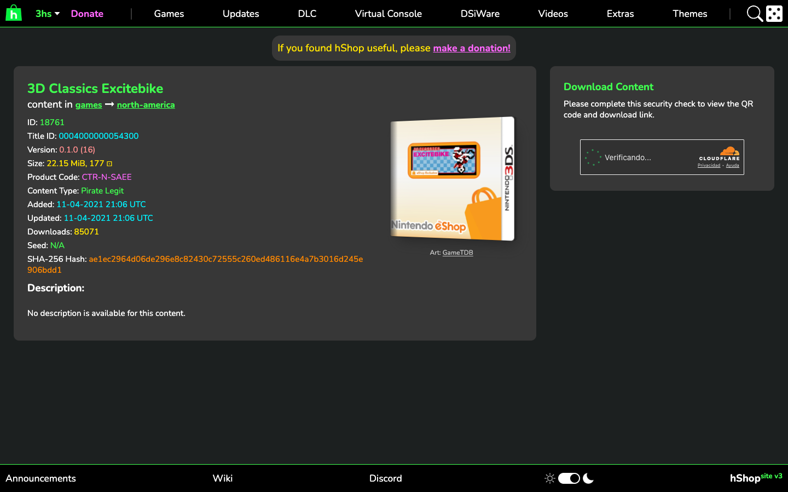

<p align="center">
  <a href="https://coverly-shelf.maecly.com/"></a>
</p>

<h1 align="center">Cada juego en la estantería, con su portada.</h1>

<p align="center">
  <b>Coverly Shelf</b> es una extensión de navegador que añade carátulas y capturas a las páginas y los listados de juegos de 3DS en hShop.<br>
  Solo cambia el aspecto: nunca toca las descargas ni el funcionamiento del sitio.
</p>

<p align="center">
  <b>Gratis</b> · <b>Sin cuenta</b> · <b>Código abierto</b>
</p>

<p align="center">
  <a href="https://github.com/MAECLY/coverly-shelf/releases/latest"></a>
  <a href="LICENSE"></a>
  <a href="#instalación"></a>
  <a href="#por-qué-es-segura"></a>
</p>

<p align="center">
  <a href="https://coverly-shelf.maecly.com/"><b>Web</b></a> ·
  <a href="#instalación">Instalación</a> ·
  <a href="#por-qué-es-segura">Seguridad</a> ·
  <a href="#desarrollo">Desarrollo</a> ·
  <a href="https://github.com/MAECLY/coverly-roms">Coverly ROMs</a> ·
  <a href="README.md">English</a> · <b>Español</b>
</p>

<p align="center">
  <picture>
    <source media="(prefers-color-scheme: dark)" srcset="docs/screenshots/title-1814-dark-1440.png">
    
  </picture>
</p>

> [!NOTE]
> **Primeros pasos, dicho claro.** Coverly Shelf 0.1.0 mejora las páginas de
> cada título (`/t/…`) y los listados (`/c/…` y los resultados de búsqueda).
> Está probada de punta a punta en Chromium sobre el sitio real, todavía no en
> Firefox. Si una página se
> ve mal, abrir un [issue](https://github.com/MAECLY/coverly-shelf/issues) con
> su URL ayuda mucho.

---

## Qué hace

**Una caja para cada juego.** En la página de un título, la portada aparece
junto a la tabla técnica como una pequeña caja en 3D, girada para que se vea el
lomo. Sigue el tema claro u oscuro de hShop y, en el móvil, se coloca encima de
la tabla.

**Portada a tamaño completo.** Pulsa la caja, o llega a ella con Tab y pulsa
Intro o Espacio, para ver la portada en grande (el escaneo de alta calidad de
GameTDB cuando existe). Esc cierra el visor y el foco vuelve a la caja. La
portada de reserva no se puede pulsar.

**Miniaturas en todos los listados.** Cada listado (juegos, actualizaciones,
DLC, Virtual Console, DSiWare, vídeos, extras y resultados de búsqueda) muestra
una miniatura de la portada al principio de cada fila, en la lista principal y
en la de “Top content”. Las filas cargan su imagen solo cuando se acercan a la
pantalla.

**También el contenido relacionado.** En la página de un título, cada fila del
bloque Related Content (sus demos, actualización, DLC o juego base) lleva la
misma miniatura.

**Demos, actualizaciones y DLC usan la portada de su juego.** Si una demo,
actualización, DLC o versión de exposición no tiene imagen propia, muestra la
portada de la fila que hShop marca como su Base Title (por ejemplo, la segunda
demo de Project X Zone muestra la portada de Project X Zone). Una fila
relacionada solo toma prestada una imagen cuando hShop dice que es el mismo
juego; nunca se adivina una portada por el nombre.

**Capturas, cuando las hay.** Bajo la descripción, una sección de capturas
muestra la pantalla de título y escenas del juego. Al pulsar una se abre en
grande: las flechas izquierda y derecha pasan de una a otra, Esc cierra y el
foco no sale del visor hasta que lo cierras.

**Primero la región correcta.** La portada sale de la región del propio juego
(leída de su código de producto, por ejemplo `CTR-P-AZEE` → EE. UU.), después
de las otras regiones en inglés y después de las carátulas de Libretro. Los
juegos de DSiWare usan las portadas de DS de GameTDB. Si no
hay nada, ocupa su sitio una portada sencilla con las iniciales del juego, así
la página nunca muestra una imagen rota.

**También los juegos solo digitales.** Los juegos de eShop (`CTR-N-…`) tienen
su portada; la extensión se salta los tipos de imagen que solo existen para
ediciones en caja.

**Créditos en la página.** Cada imagen dice de dónde sale (“Art: GameTDB”,
“Art: Libretro”).

**Discreta y rápida.** La portada elegida y la lista de capturas se guardan en
caché (7 días por defecto), fallos incluidos, así que una segunda visita no
hace peticiones nuevas y no se vuelve a pedir lo que no existe. Cada imagen
candidata se comprueba antes con una pequeña petición HEAD, así que lo que no
existe se descarta sin descargarlo. Nunca hay más de 4 peticiones de imagen a
la vez, ni más de 2 al propio hShop (solo para filas de “Top content” que no
muestran código de producto). Las entradas caducadas se borran una vez al día,
así que la caché no crece sin fin.

**Ajustes.** Pulsa el botón de la extensión en la barra de herramientas para
abrir su página de ajustes (en inglés y en español). Elige cuánto tiempo se
guardan las imágenes: esta sesión, 1 día, 7 días, 30 días o hasta que la
borres. La página muestra cuántos juegos hay en caché y cuánto ocupan, y
**Borrar caché** la vacía al momento (tras confirmarlo).

<table>
  <tr>
    <td width="50%"></td>
    <td width="50%"></td>
  </tr>
  <tr>
    <td align="center"><sub>El visor de capturas</sub></td>
    <td align="center"><sub>Un juego solo digital (3D Classics Excitebike)</sub></td>
  </tr>
</table>

## Por qué es segura

- **Solo aspecto.** Añade sus propios elementos a la página (la portada, las
  capturas, una miniatura por fila), cada uno en su propio shadow root, más
  marcas `data-hshop-enhanced` y, en las páginas con miniaturas, un pequeño
  `<style>` que les hace sitio, y nada más. No lee, cambia
  ni pulsa los botones de descarga, el código QR ni ningún enlace. Si algo
  falla (cambió la maquetación, falta una imagen, no hay red), quita lo que
  añadió y la página queda exactamente como estaba.
- **Permisos mínimos.** El manifiesto pide `storage` (la caché y los ajustes)
  y acceso solo a dos servidores de imágenes: `art.gametdb.com` y
  `thumbnails.libretro.com`. Los content scripts solo se ejecutan en
  `hshop.erista.me/t/*`, `/c/*` y `/search/results*`. Sin `tabs`, sin
  `<all_urls>`, sin acceso a otros sitios. El botón de la barra de
  herramientas no necesita ningún permiso.
- **Sin rastreo.** Sin analítica, sin telemetría, sin cuenta y sin servidor
  propio. Las únicas peticiones que hace son imágenes de esos dos servidores,
más la página de un título del propio hShop para una fila de “Top content” que
no muestra código de producto. La
  tabla que relaciona códigos de producto con nombres de Libretro va dentro de
  la extensión.
- **Código abierto.** Todo el código está aquí, bajo la AGPL-3.0.

## Instalación

Coverly Shelf aún no está en la Chrome Web Store. Se instala desde una versión
publicada:

1. Descarga `coverly-shelf-<versión>-chrome.zip` de la
   [última versión](https://github.com/MAECLY/coverly-shelf/releases/latest) y
   descomprímelo.
2. Abre `chrome://extensions` (o `edge://extensions`, `brave://extensions`) y
   activa el **Modo de desarrollador**.
3. Pulsa **Cargar descomprimida** y elige la carpeta descomprimida.
4. Abre cualquier juego o listado en [hShop](https://hshop.erista.me/), por
   ejemplo una página bajo `/t/` o `/c/`.

Para actualizar, descomprime la nueva versión sobre la misma carpeta y pulsa el
botón de recargar en la tarjeta de la extensión.

## Desarrollo

Necesitas [Bun](https://bun.sh/) 1.4 o posterior y Chrome o Chromium.

```sh
bun install            # instala las dependencias (también ejecuta `wxt prepare`)
bun run dev            # abre Chrome con la extensión cargada y recarga en vivo
bun run check          # tipos, tests unitarios (vitest + happy-dom) y build de producción
bun run build          # genera .output/chrome-mv3
bun run zip            # genera el zip de la versión en .output/
bun run gen:libretro   # regenera public/libretro-3ds.json desde libretro-database
bun run e2e            # compila y prueba la extensión en el sitio real con Playwright
bun run e2e:lists      # recorre todos los listados con la extensión compilada (largo)
bun run e2e:options    # comprueba la página de ajustes y el botón de la barra
bun scripts/icons.ts   # vuelve a generar public/icon/*.png desde design/icon/
```

Para probar un build en tu navegador de siempre: ejecuta `bun run build`, abre
`chrome://extensions`, activa el **Modo de desarrollador**, pulsa **Cargar
descomprimida** y elige `.output/chrome-mv3`. Tras recompilar, pulsa el botón de
recargar en la tarjeta.

`bun run e2e` necesita red: carga páginas reales de hShop e imágenes reales.
Guarda las capturas en [docs/screenshots](docs/screenshots). Con
`E2E_HEADED=1` ves la ventana mientras corre.

Hay builds para Firefox (`bun run build:firefox`), pero no están probados ni
listos para AMO.

### Arquitectura

```
extract  →  sources  →  resolver  →  ui
```

| Paso | Archivos | Qué hace |
|---|---|---|
| **extract** | `src/lib/extract.ts`, `selectors.ts`, `lookup.ts` | Lee el título, el código de producto, el Title ID y la región de las páginas de título, de las filas de los listados y de las filas de Related Content. Sin código de producto (temas, homebrew) no hay nada que hacer. |
| **sources** | `src/lib/sources/gametdb.ts`, `libretro.ts`, `public/libretro-3ds.json` | Convierte un juego en URLs de imagen ordenadas: portadas de GameTDB por región y carátulas, pantallas de título y capturas de Libretro por nombre No-Intro. |
| **resolver** | `src/lib/resolver.ts`, `related.ts`, `probe.ts`, `queue.ts`, `cache.ts`, `settings.ts` | Prueba los candidatos en orden (primero con HEAD, gana el primero que existe, como mucho 4 a la vez), aplica el respaldo del juego base y guarda el resultado el tiempo elegido. |
| **ui** | `src/ui/*`, `src/entrypoints/{title,list}.content/`, `options/` | Dibuja la caja, el visor a tamaño completo, la portada de reserva, la galería, las miniaturas de las filas y la página de ajustes, con los colores del propio hShop. |

El service worker (`src/entrypoints/background.ts`) responde a tres mensajes:
los nombres de Libretro de un código de producto, la comprobación HEAD de una
URL de imagen (`image:head`) y una descarga de imagen que queda de reserva para
el día en que hShop añada una Content Security Policy (`IMAGE_MODE` en
`src/lib/config.ts`). También abre la página de ajustes desde el botón de la
barra y borra las entradas caducadas de la caché.

Cada selector, color y patrón de URL que usa el código está anotado en
[docs/REFERENCE.md](docs/REFERENCE.md). Lo que aún hay que comprobar en el sitio
real está en [docs/ASSUMPTIONS.md](docs/ASSUMPTIONS.md).

## Créditos

- [GameTDB](https://www.gametdb.com/), por las portadas de 3DS.
- [Libretro](https://www.libretro.com/):
  [libretro-thumbnails](https://github.com/libretro-thumbnails/libretro-thumbnails)
  por las carátulas, pantallas de título y capturas, y
  [libretro-database](https://github.com/libretro/libretro-database) por los
  nombres No-Intro que hay detrás.
- [WXT](https://wxt.dev/), [Tailwind CSS](https://tailwindcss.com/),
  [Vitest](https://vitest.dev/) y [Playwright](https://playwright.dev/).

Las imágenes se cargan desde sus servidores al ver la página; la extensión no
incluye ninguna. El arte de los juegos pertenece a sus dueños. hShop no tiene
relación con este proyecto. Fuentes, patrones de URL y qué se verificó:
[docs/REFERENCE.md](docs/REFERENCE.md).

## Licencia

Coverly Shelf es software libre, con licencia
[GNU Affero General Public License v3.0 only](LICENSE) (`AGPL-3.0-only`).
Copyright © 2026 Miguel Angel Esparza Calero (MAECLY).

Forma parte de la familia Coverly. Su hermana,
[Coverly ROMs](https://github.com/MAECLY/coverly-roms), rellena las portadas que
faltan en la tarjeta SD de tu consola portátil.

---

<p align="center">
  <sub>Hecho por Miguel Angel Esparza Calero · <a href="https://coverly-shelf.maecly.com/">coverly-shelf.maecly.com</a></sub>
</p>
